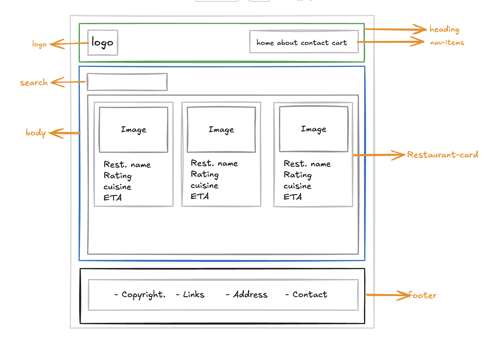
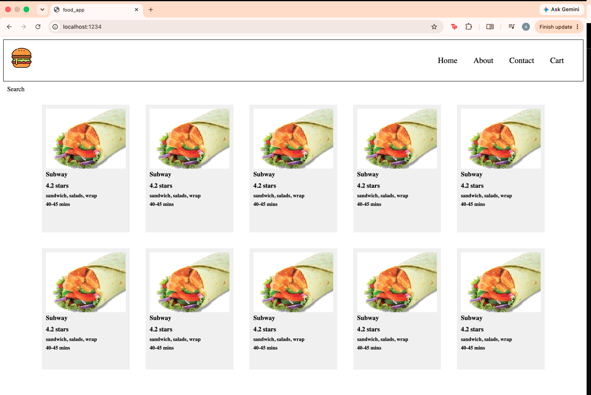
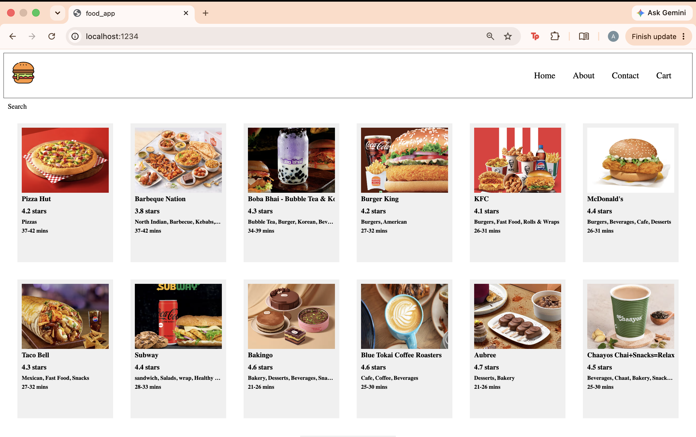

# Build a Food Delivery App

These notes follow the [Thinking in React](https://react.dev/learn/thinking-in-react) workflow while building a small food delivery app with React.

## 1. Initialize a Node.js Project

Create a `package.json` file:
```bash
npm init
```
Or initialize it with default values:
```bash
npm init -y
```

## 2. Install Parcel

```bash
npm install -D parcel
```

## 3. Install React and React DOM

```bash
npm install react react-dom
```

## 4. Add npm Scripts

Update `package.json`:
```json
"scripts": {
    "start": "parcel index.html",
    "build": "parcel build index.html"
}
```

## 5. Start the Application

Make sure `index.html` exists, then run:

```bash
npm start
```

Parcel serves the app locally and rebuilds it when source files change.

## Step 1: Break the UI into a Component Hierarchy



- **Header**
    - Logo
    - Navigation items
- **Body**
    - Search
    - Restaurant container
        - Restaurant card
            - Food image
            - Name
            - Rating
            - Cuisine type
            - Delivery time
- **Footer**
    - Copyright
    - Links
    - Address
    - Contact

### Inline Styles in JSX

Inline styles are JavaScript objects. JSX uses one set of braces to enter JavaScript and a second set to provide the object:
Example:

```jsx
const styleCard = {
    backgroundColor: "#f0f0f0",
}
        
const RestaurantCard = () => {
    return (
        <div className="restaurant-card" style={styleCard}>
            <h3>Restaurant Name</h3>
            <p>Restaurant Description</p>
        </div>
    )
}
```
The object can also be written directly in the element:

```jsx
const RestaurantCard = () => {
    return (
        <div className="restaurant-card" style={{backgroundColor: "#f0f0f0"}}>
            <h3>Restaurant Name</h3>
            <p>Restaurant Description</p>
        </div>
    )
}
```
In `style={{ backgroundColor: "#f0f0f0" }}`, the outer braces enter JavaScript and the inner braces define the style object.

So far, we have built a React food ordering app UI with three main components: a Header with logo and navigation menu (Home, About, Contact, Cart), a reusable RestaurantCard component displaying restaurant details (image, name, rating, cuisine type, and delivery time), and a responsive grid layout that displays multiple cards.


## Step 2: Build a Static Version with Props

If every card displays the same restaurant, the component is probably hardcoded. To display different restaurants, keep the component reusable and pass each restaurant's data through props.

The goal is to render the UI from a data model instead of duplicating markup.

### What Are Props?

Props are values passed from a parent component to a child component, similar to function arguments.

Pass props to a component:
```jsx
<RestaurantCard resName="Subway" rating="4.2" cuisine="sandwich, salads, wrap" time="40-45 mins" />
```

Read props inside the component:
```
const RestaurantCard = (props) => {
    return <div>{props.resName}</div>;
}
```

### Destructure Props

Instead of repeatedly writing `props.propertyName`, destructure the values in the function parameter:
```
const RestaurantCard = ({ resName, rating, cuisine, time }) => {
    return (
        <div className="restaurant-card" style={styleCard}>
            
            <h3>{resName}</h3>
            <h3>{rating} stars</h3>
            <h4>{cuisine}</h4>
            <h4>{time}</h4>
        </div>
    )
}
```
## Step 3: Build a Config-Driven UI

A config-driven UI is built from a data structure instead of hardcoded markup. In a food delivery app, this configuration usually comes from an API and can change based on the user, location, availability, or time.

The component controls how a restaurant looks; the data controls which restaurant is displayed.

### Render a List with `map()`

Avoid calling the component repeatedly by hand. Use `map()` to create one card for each restaurant:

```jsx
<div className="res-container">
    {restaurants.map((restaurant) => (
        <RestaurantCard
            key={restaurant.info.id}
            resData={restaurant.info}
        />
    ))}
</div>
```

### Use a Stable `key`

React requires a `key` when rendering a list. The key lets React identify which item was added, removed, or moved so it can update the correct component efficiently.

Use a stable unique ID from the data:

```jsx
key={restaurant.info.id}
```

Avoid using the array index as a key when the list can be reordered, inserted into, or deleted from. An index does not identify the item itself and can associate state or DOM elements with the wrong restaurant.

## Key Takeaways

- Break the interface into focused components.
- Pass changing data through props.
- Keep UI configuration separate from presentation.
- Use `map()` for repeated components.
- Give list items stable, unique keys.

## References

- [Thinking in React](https://react.dev/learn/thinking-in-react)
- [React without JSX](https://react.dev/reference/react/createElement)
- [React reconciliation](https://legacy.reactjs.org/docs/reconciliation.html)
- [Index as a key is an anti-pattern](https://robinpokorny.com/blog/index-as-a-key-is-an-anti-pattern/)