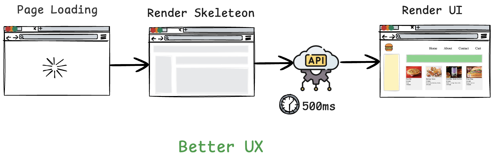
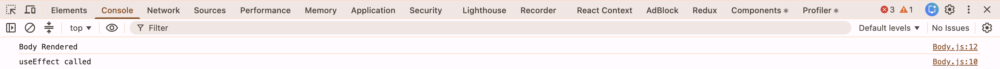
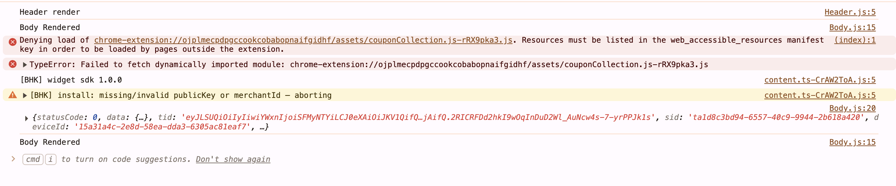

# Monolithic Architecture

In a **monolithic architecture**, most of the application's functionality is developed and deployed as a single application.
For example:
```text
Food Delivery Application
│
├── Authentication
├── Restaurant Management
├── Order Management
├── Payment Logic
├── Notification Logic
└── Database Access
```
These modules may still be organized into different folders, classes, or packages, but they belong to the same deployable application.
For small and medium-sized applications, a well-designed monolith can actually be easier to:
* develop,
* test,
* deploy,
* debug,
* and maintain.

# Microservices Architecture

Now imagine our food-delivery platform grows enormously. Different teams manage different parts of the application.Instead of keeping all business capabilities inside one backend application, we may split them into independently deployable services.
For example:

```text
                        ┌──────────────────┐
                        │    React UI      │
                        └────────┬─────────┘
                                 │
                                 ↓
                         ┌──────────────┐
                         │ API Gateway  │
                         └───────┬──────┘
                                 │
             ┌───────────────────┼───────────────────┐
             ↓                   ↓                   ↓
      ┌─────────────┐     ┌─────────────┐     ┌─────────────┐
      │ Restaurant  │     │   Order     │     │    User     │
      │   Service   │     │   Service   │     │   Service   │
      └─────────────┘     └─────────────┘     └─────────────┘
             │                   │                   │
             ↓                   ↓                   ↓
          Database            Database            Database
```

We could also have other services such as:
```text
Payment Service
Notification Service
Search Service
Recommendation Service
Authentication Service
```
Each service focuses on a particular **business capability**.
For example:
```text
Order Service → Responsible for orders
Payment Service → Responsible for payments
Notification Service → Responsible for emails/SMS/push notifications
```
This follows an important engineering idea:
> **Separation of Concerns:** Different parts of the system should be responsible for different concerns.
It also relates to:
> **Single Responsibility Principle:** A component or service should have a clearly defined responsibility.

---

## Monolith vs Microservices

| Monolith                                 | Microservices                                      |
| ---------------------------------------- | -------------------------------------------------- |
| Usually one deployable application       | Multiple independently deployable services         |
| Modules live inside the same application | Business capabilities can run as separate services |
| Easier to start with                     | More infrastructure complexity                     |
| Deployment usually happens together      | Services can usually be deployed independently     |
| Easier local development                 | Requires service communication                     |
| Good choice for many applications        | Useful when scale/team boundaries justify it       |

# Our React Application Needs Data

## Approach 1 — Wait for Data Before Showing the Meaningful UI 
As soon as the page loads, we can make the API call to fetch data, wait for the data to come and render it on the UI. In this case if the API takes 500 ms then the page loads for 500 ms then renders the data.

The user may see a blank screen or blocking loading experience until the required data becomes available. The disadvantage is that the user may feel like the application is taking longer to respond.

##  Approach 2 — Render First, Fetch Data Afterwards
As soon as the page loads we will render the UI and then we will make the API call and re-render our application with the data.

This usually creates a better **perceived user experience** because the application responds immediately and can show useful feedback while data is being loaded.
In client-side React applications, this is a very common pattern.

# UseEffect
useEffect hook – This takes two arguments the first one is `callback function` and the second is `dependency array` which is **optional**.
## When is useEffect callback function called?
The callback function in the useEffect is called after the component is rendered.	
```
const Body = () => {
    const [resObj, setResObj] = useState(resList);
    useEffect(() => {
        console.log("useEffect called");
    }, []);
    console.log("Body Rendered");
    return (
        <div className="body">
            <div className="filter">
                ...
            </div>

        </div>
    )
}
```

Once the rendering cycle of the body components is finished, it will call the callback function which we have passed in the `useEffect`

## Why Are We Learning `useEffect` Now?
Remember the data-fetching approach we wanted:
```text
Render UI → Make API Call → Receive Data → Update UI
```
That maps perfectly to something like:
```text
Component Render → useEffect → API Request → API Response → setState() → Component Re-renders
```
This is why `useEffect` commonly appears when learning API calls in React.

# CORS error; How to bypass CORS issue?

* Our browsers block us from calling API’s from one origin to the other origin.
* If your browser is Google, add the Google CORS extension.

# Optional Chaining – json?.data?.cards[4]?.card?.card?.gridElements?.infoWithStyle?.restaurants

Optional chaining (?.) is a feature in JavaScript that allows you to safely access deeply nested properties, methods, or array elements without having to check if each level exists manually.
If the value before ?. is null or undefined, it short-circuits and returns undefined instead of throwing a runtime error (Cannot read property of undefined). Remember, it is only for reading properties or calling functions.

# Why do we need state variables? 
When we use the state variables react updates the variable value and updates the UI.
When a state variable is changed the whole component is re-rendered and not just the specified part where the data is changed. 

# Since the variable that we use in useState is a constant variable. How are we able to update the const variable? (or) Why does a const state variable update during a useEffect fetch in React?

* The const state variable does not actually change or mutate; instead, React **throws away the old variable** and **creates a brand-new** one every single time your component re-renders.
* When the useEffect hook triggers a data fetch, it calls `setResObj` with the new data. React then re-renders the `Body component`, which completely recreates the component function and assigns the new data to a **brand-new `resObj` variable**.

Refer to , 
According to the code, 
```
const [resObj, setResObj] = useState([]);
```
at step 2 (Render Skeleton), in the above diagram, if we render the page normally while resObj is empty, the user may briefly see an empty or incomplete UI while waiting for the API response. 
> This is not a good UX.

* One solution is to display a traditional loading spinner while the data is being fetched.
* However, many modern applications use a Shimmer UI instead of showing only a spinner. 

# Why Use Shimmer/Skeleton UI?

A Shimmer or Skeleton UI provides a better perceived loading experience because users can already see the approximate structure of the page while the actual data is being fetched.
Instead of:
Loading... ⏳
the user sees something resembling the final page:

┌─────────────────────────────┐
│   ███████████████████████   │
│                             │
│  ███████   ███████████████  │
│  ███████   ███████████████  │
│  ███████   ███████████████  │
└─────────────────────────────┘
This does not make the API request faster, but it can make the application feel faster and more responsive.

```markdown
> **Whenever a state variable updates, React triggers a re-render of the component. During this process, React performs reconciliation to determine what needs to be updated in the DOM.**



1. `Body` renders for the first time with the initial state, `resObj = []`.
2. After the first render, `useEffect()` runs and starts the API request.
3. When the API response arrives, `setResObj(data)` is called.
4. `setResObj()` updates the state and tells React that the component needs to re-render.
5. React executes the `Body` component function again, which produces the second `"Body Rendered"` log.

> **Flow:** Initial Render → API Fetch → State Update → Re-render
```

