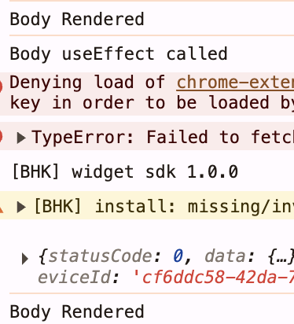

# useEffect Hook
`useEffect()` is used to run **side effects** such as API calls, subscriptions, timers, etc., after a component renders.
```js
useEffect(() => {
    console.log("Body useEffect called");
    fetchData();
}, []);

console.log("Body Rendered");
```
`useEffect()` takes two parameters:
- **Callback function** → contains the side-effect logic.
- **Dependency array** → controls when the effect runs.

### Dependency Array Behavior

- **No dependency array** → useEffect runs after every render.
- **Empty array `[]`** → runs only after the initial render.
- **With dependencies `[value]`** → runs after the initial render and whenever `value` changes.

> In the example above, `Body` renders first → `useEffect` runs → API data updates the state → `Body` renders again. Since the dependency array is empty, `useEffect` does not run again.


# Note:

* It is a bad practice to create a component inside another component, because everytime the outer component gets rendered, the inner component gets created.
* Never declare a state variable inside an `if-else` block, because then React wouldn't know when that variable should be created. This causes inconsistencies in React.
* Also, never declare a state variable inside a `for` loop, because it doesn't make sense to initialise a state variable again and again, when we can just change it's value using the set function.
* React provides us `useState` hooks to create a local state variable inside our functional component. That's why we should never use `useState` outside a component.
* Declare state Hooks at the top level of the component to maintain a consistent Hook call order across renders. 

# Routing and react-router-dom
We will create different pages for different texts like Home, About, Contact and Cart.
On clicking those texts in the UI, we should be routed to a different page. 

To achieve the above we need an npm package - `react-router-dom`. This will enable us to implement dynamic routing in web app.
```
npm i react-router-dom
```
## createBrowserRoute()
- `createBrowserRoute()` from `react-router-dom` is used to create the routing configuration.
- it takes list of objects
- each object will have path and element.
```
const appRouter = createBrowserRoute([
    {
        path: "/",
        element: <AppLayout/>
    }
]);
``` 
## RouterProvider
- But just creating this configuration is not enough. We will need to provide this configuration to render it on to the page.
- To do this, we use `RouteProvider` which will provide the routing configuration to the app.
```
const root = ReactDOM.createElement(document.getElementById("root"));
root.render(<RouterProvider router={appRouter} />)
```

### rafce
`rafce` stands for `React Arrow Function Component with Export Default`. It is a highly popular code snippet shortcut used in Visual Studio Code (VS Code) to instantly generate boilerplate code for a new React component.
## useRouteError hook
## Children Routes | Outlet
## Link instead of anchor tag (`<a>`) with the `href` attribute
```
< Link to="/">About Us<Link />
```
# Two types of routing
- Client Side routing
- Server Side routing

# Dynamic Routing
# GraphQL


1. createBrowserRoute()
2. Outlet
3. useRouteError - errorElement
4. SPA
5. Dynamic Routing (id attached to an url / useParams hook)
6. Link to
7. 


